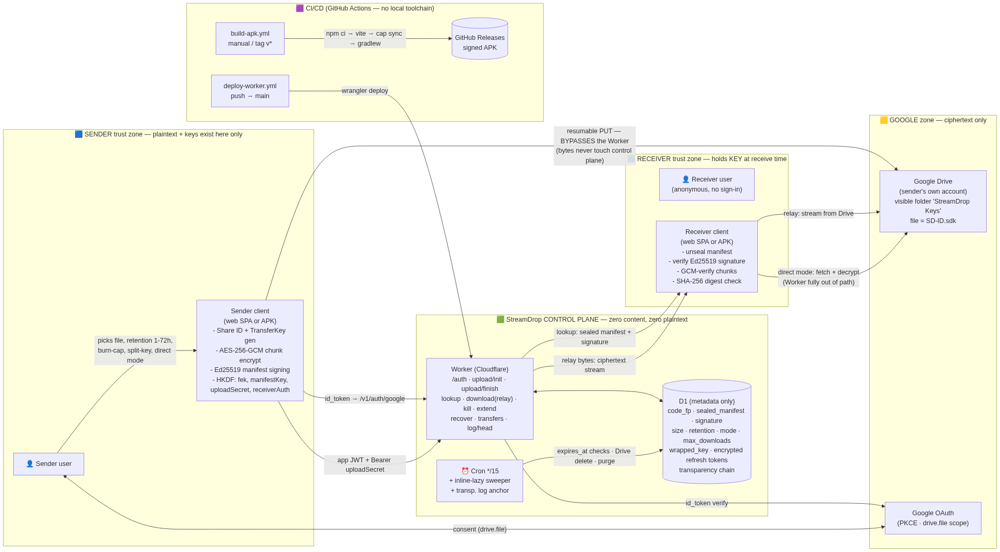
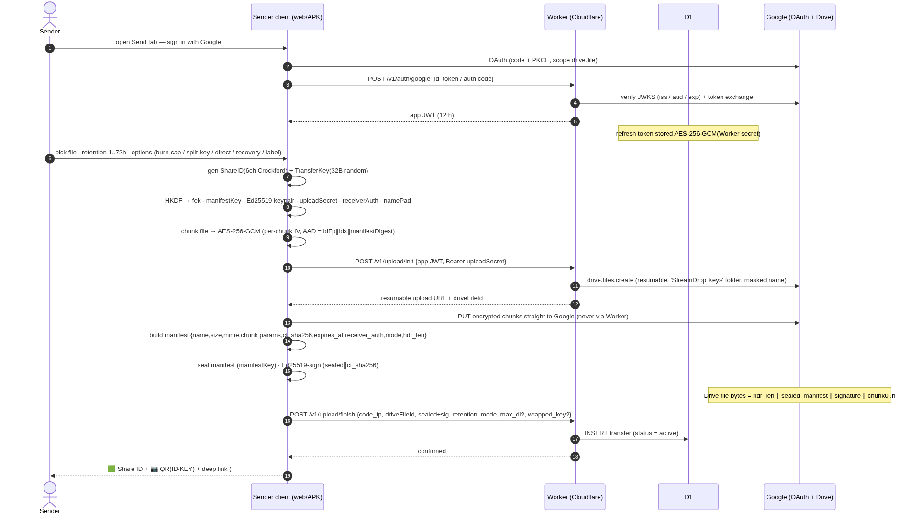
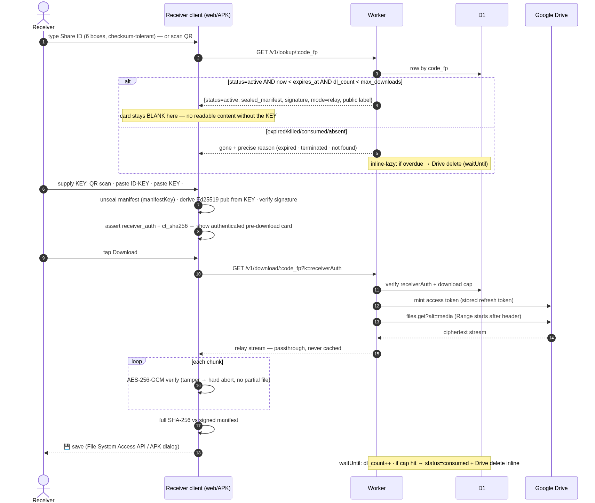
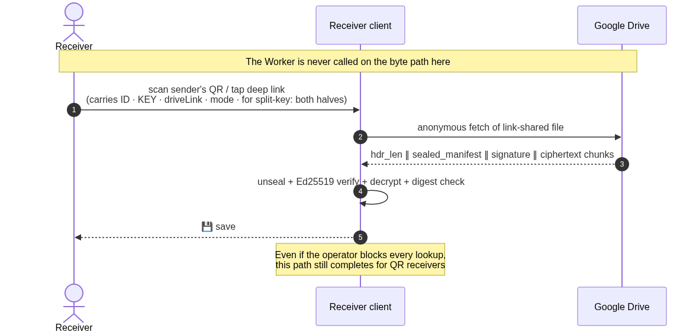
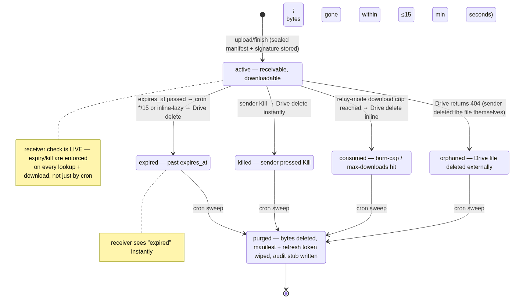
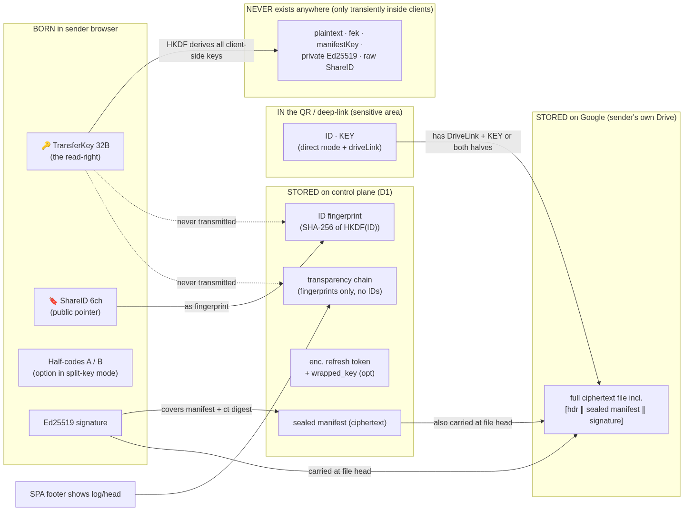
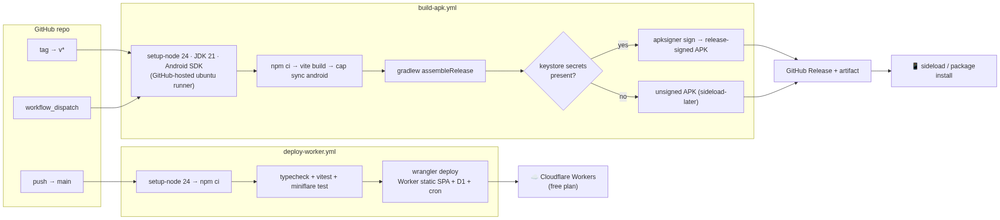

# StreamDrop — historical diagram renders (v2.1)

> ⚠️ **Historical, and partial.** These are the v2.1 diagram *images* (OAuth redirect, server-held
> refresh tokens, D1 transfer rows, Google Drive storage, the Cron sweeper). The **current**
> diagrams are in [`DIAGRAMS.md`](DIAGRAMS.md) and the architecture is in
> [`ARCHITECTURE-v5.md`](ARCHITECTURE-v5.md) — there is no server at all any more.
>
> Note honestly: when the diagram set was replaced for v5, the Mermaid *source* of the v2.1
> diagrams was not retained (the render script targets one document). The rendered PNGs below are
> the surviving record, alongside [`DESIGN.md`](DESIGN.md), the approved v2.1 design.

| Diagram | Image |
|---|---|
| System architecture — components & trust boundaries (sender zone, StreamDrop control plane, Google zone, receiver zone, CI/CD) |  |
| Send flow — pick a file, encrypt, resumable upload to the sender's own Drive |  |
| Receive flow — relay mode: Worker streams ciphertext from Drive |  |
| Receive flow — direct mode: the receiver fetches from Drive, the Worker fully out of the path |  |
| Transfer lifecycle — active → expired → swept, plus Kill |  |
| Secrets map — what each party could see |  |
| CI/CD — Worker deploy on push, APK build on tag |  |
