# StreamDrop — diagrams (v5, the current architecture)

Rendered as images via `node scripts/render-diagrams.mjs` (mermaid.ink). The Mermaid source is kept
in collapsible blocks so the images can be regenerated at any time. The v2.1 set lives in
[`DIAGRAMS-v2.1.md`](DIAGRAMS-v2.1.md); the architecture itself is described in
[`ARCHITECTURE-v5.md`](ARCHITECTURE-v5.md).

---

## 1. System architecture — two devices, one third-party nobody, no server

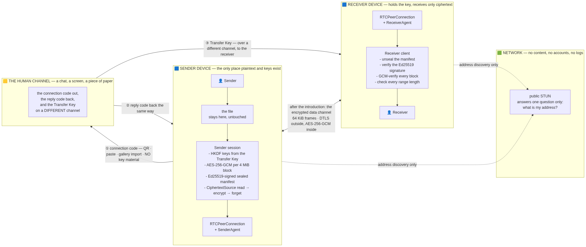

Mermaid source

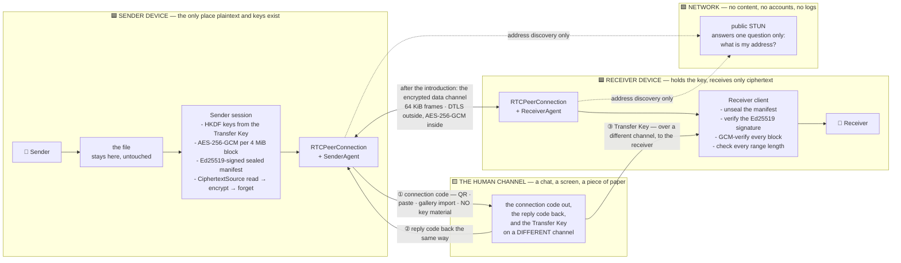

---

## 2. The handshake — what each artifact is and why the key is separate

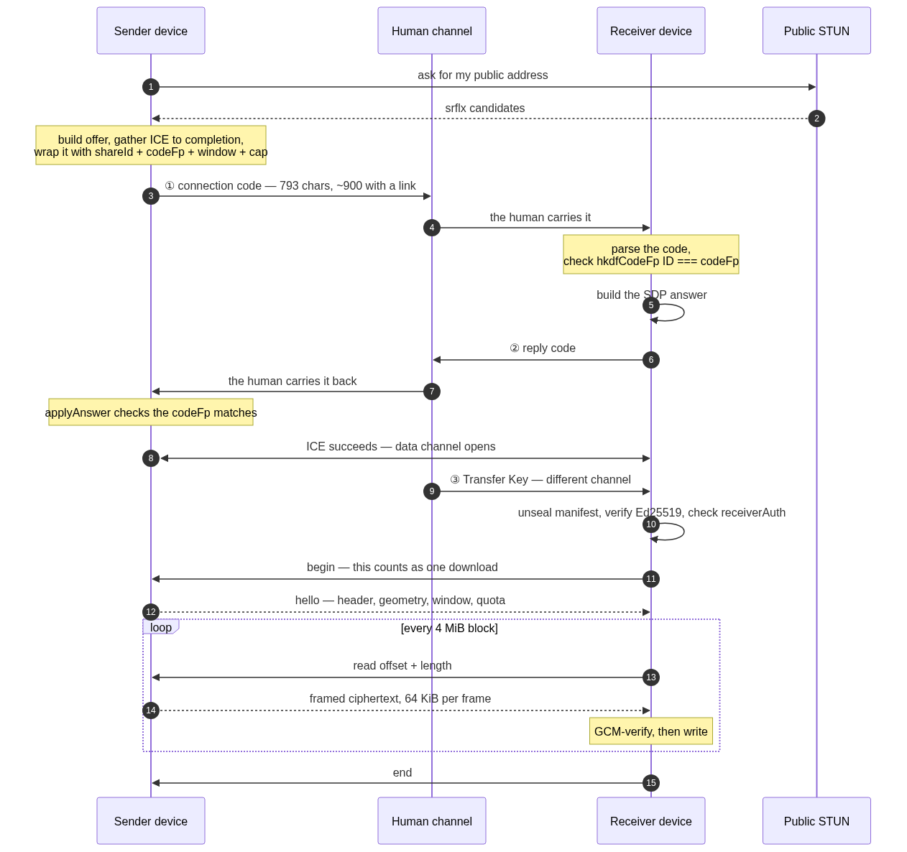

Mermaid source

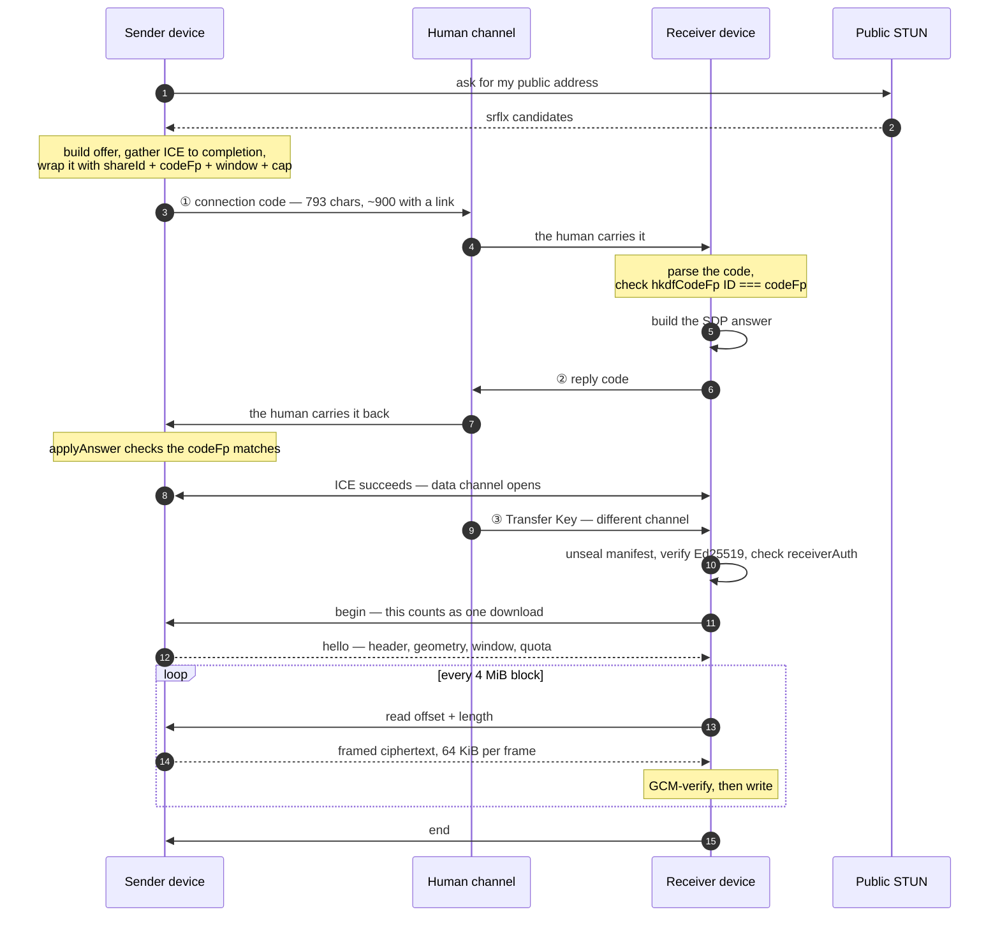

**Why the key is not in the code.** A man-in-the-middle who sits in the chat can substitute their
own code — but the signing key is derived from the Transfer Key travelling on a different channel,
so a forged manifest fails verification. The "receive link" button merges the two on purpose and
says plainly that anyone holding that URL can open the file.

---

## 3. Sender: from a file to a live share

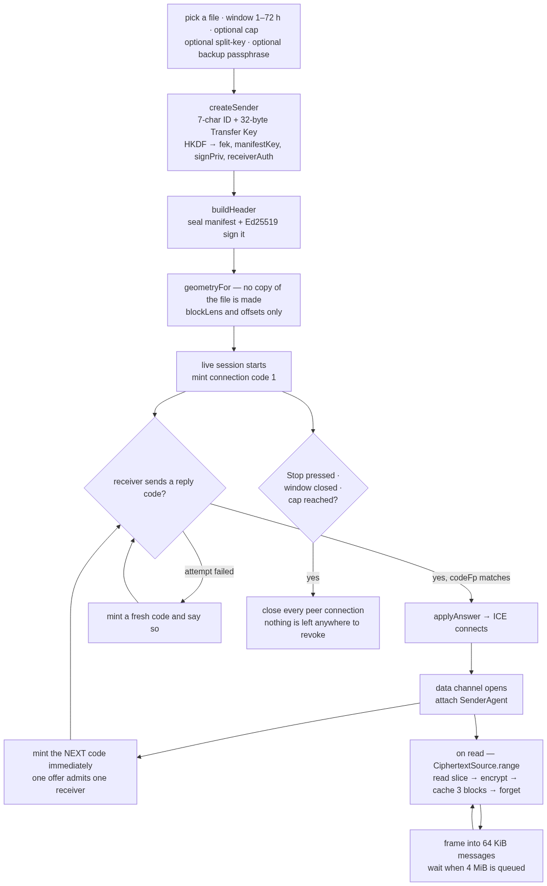

Mermaid source

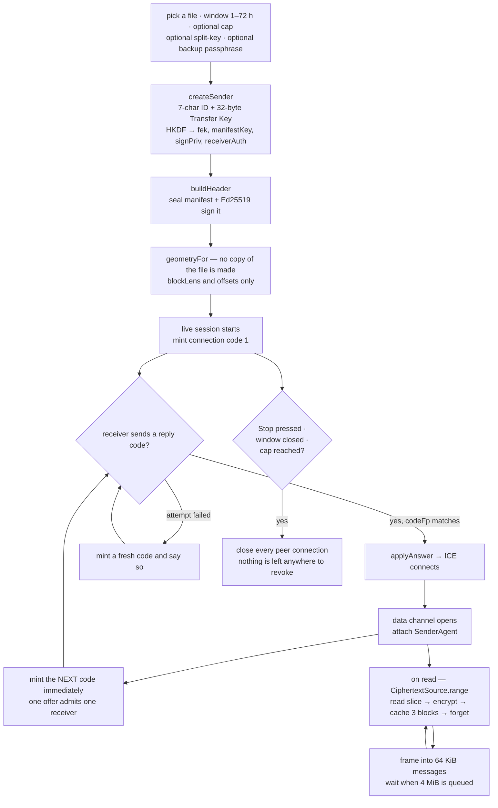

---

## 4. Receiver: from a code to a verified file

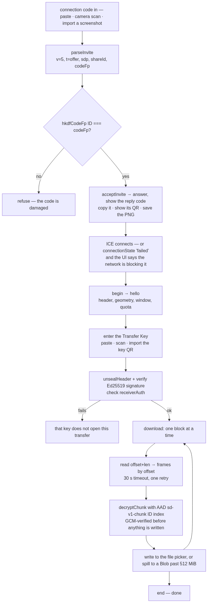

Mermaid source

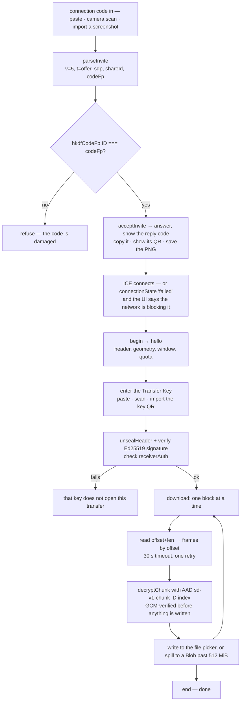

---

## 5. The wire protocol — the same conversation v4's relay had, minus the relay

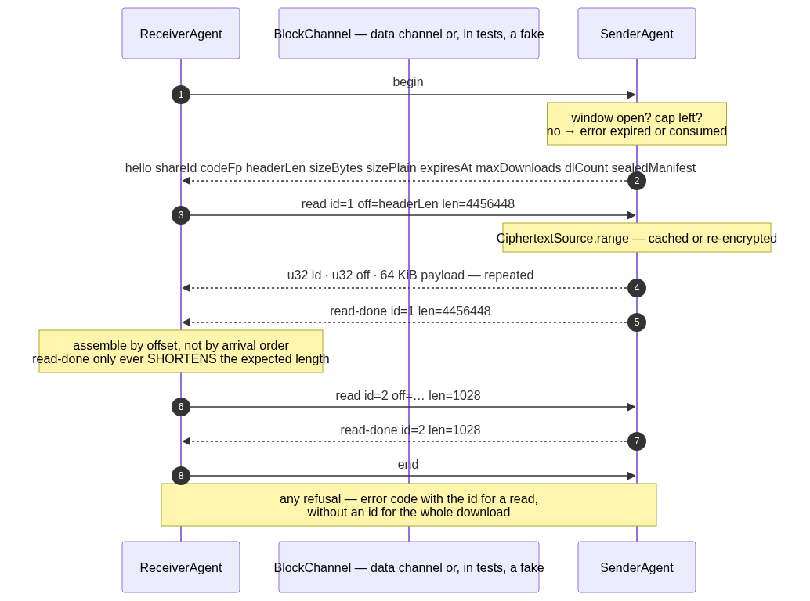

Mermaid source

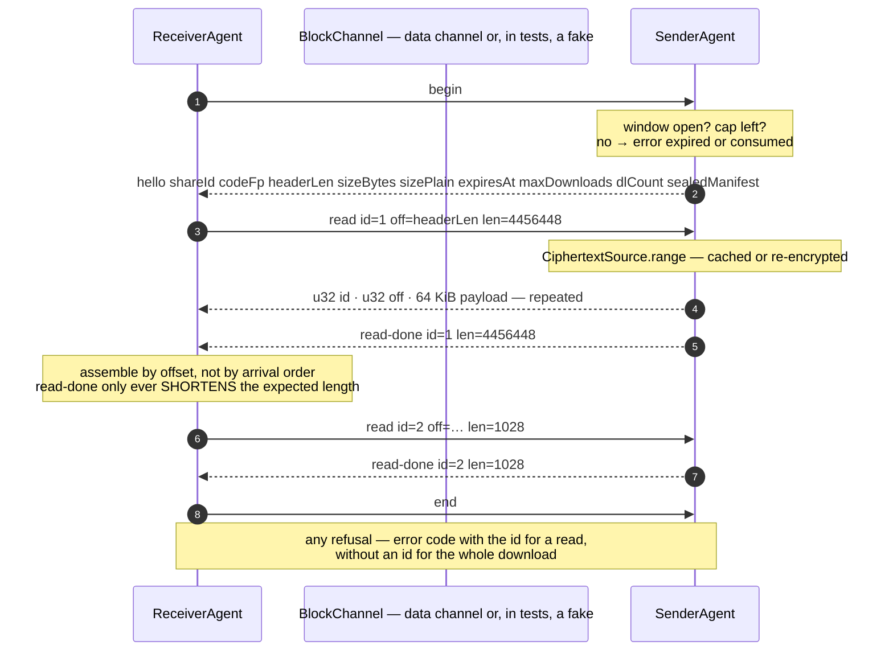

---

## 6. The container and the keys — unchanged since v3

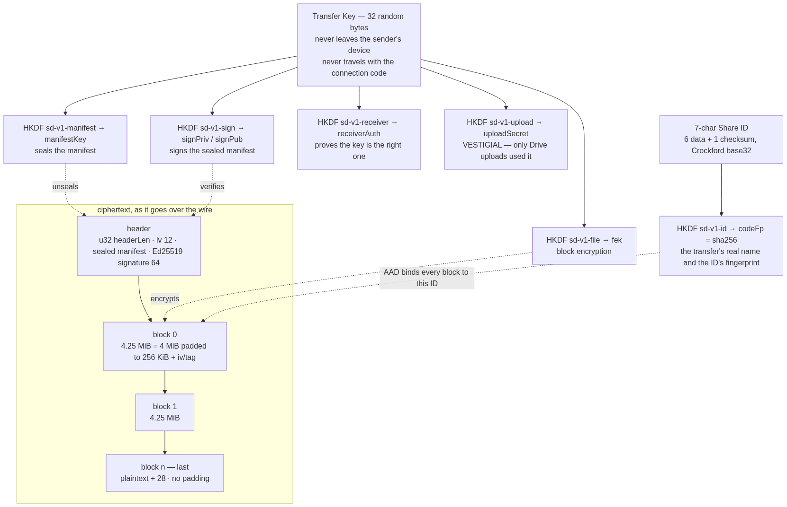

Mermaid source

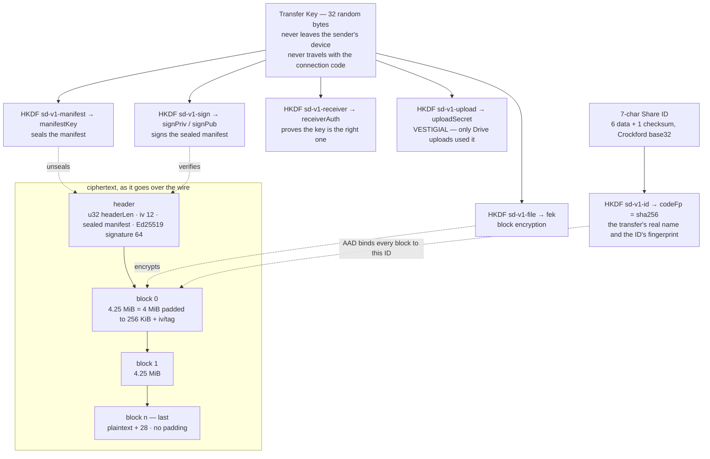

---

## 7. Lifecycle — there is nothing to clean up, and that is the point

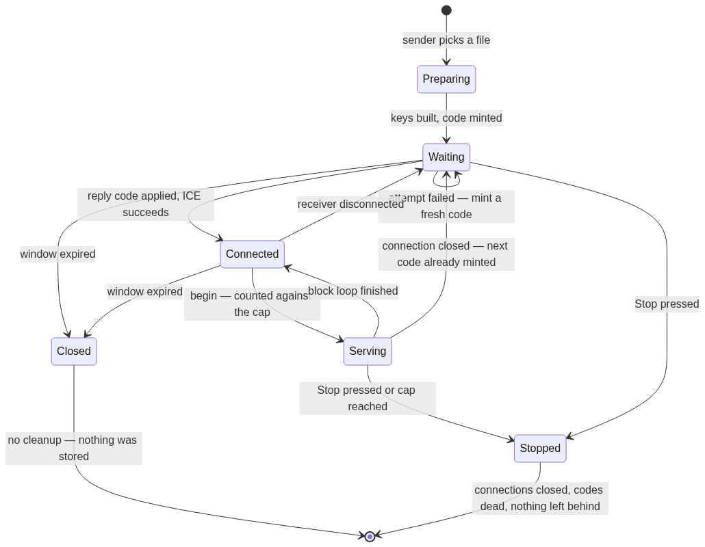

Mermaid source

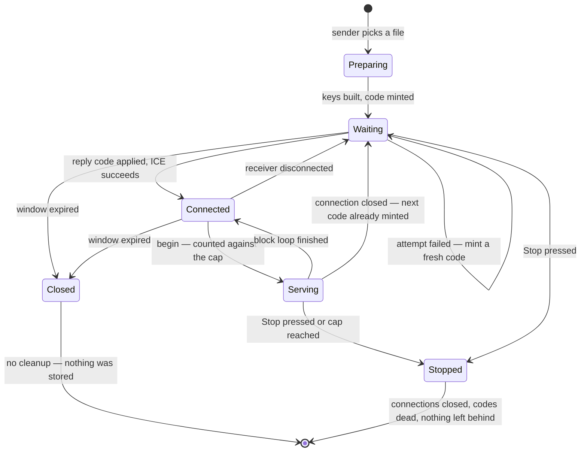

---

## 8. CI/CD — quality on the runner, and an APK that needs no host

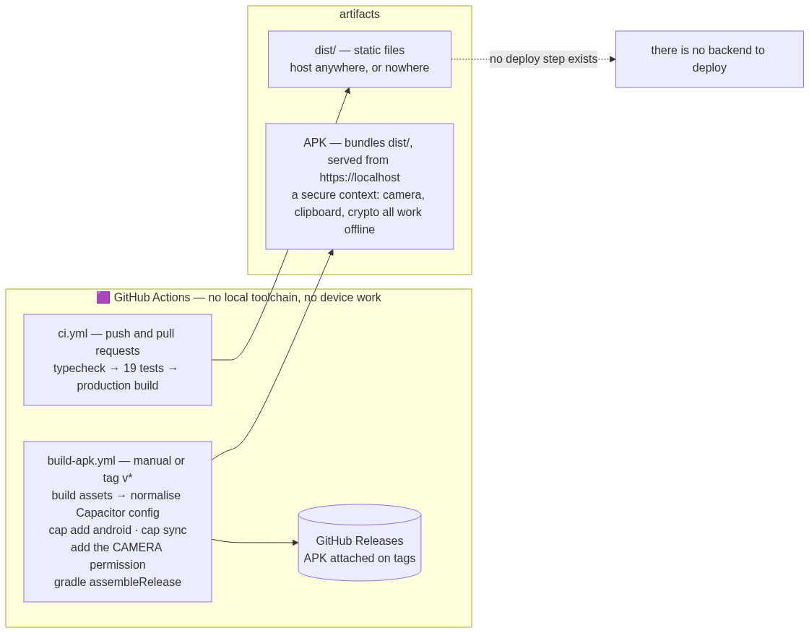

Mermaid source

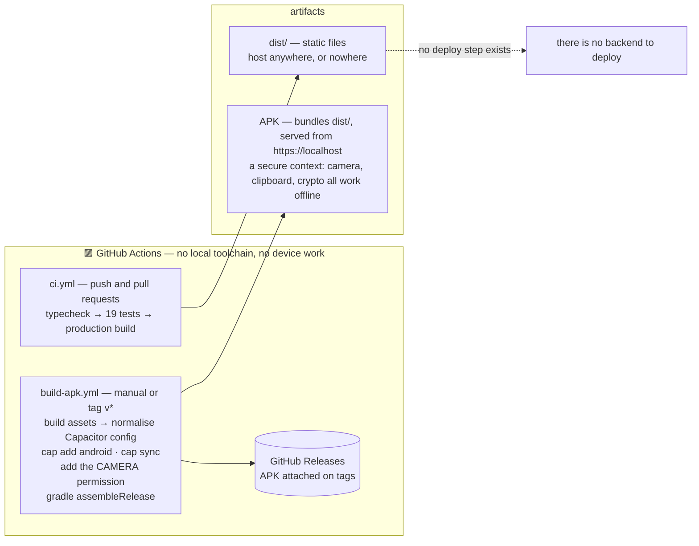

